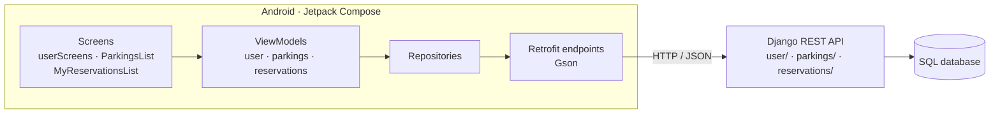

# Parking Reservation · Android App


An Android app for finding parking lots in Algeria (organized by wilaya, daïra and commune). Users sign up, browse parkings with photos and descriptions, and see their reservations. Booking is handled by the backend API. It is built with Jetpack Compose (MVVM) and talks to a [Django REST backend](https://github.com/MehdiBedja/Reservation-app-backend).

## Screenshots

| Login | Parkings | My reservations |
| --- | --- | --- |
|  |  |  |

<!-- Screenshot placeholders: add images to docs/screenshots/ -->

## Features

- Sign up and log in (token auth)
- Parking list with images (Coil), description and commune
- "My reservations" list with entry/exit times, payment status and reservation code

## Architecture



```
app/src/main/java/com/example/reservation_app_frontend/
├── screen/       # Compose UI (user, parking, reservation)
├── viewModel/    # state + calls to repositories
├── repository/   # wraps the endpoints
├── endpoint/     # Retrofit interfaces
├── data/         # Parking, Reservation, User models
└── network/      # base URL
```

## Run

1. Start the [backend](https://github.com/MehdiBedja/Reservation-app-backend) locally (or expose it with ngrok).
2. Set its address in `app/src/main/java/com/example/reservation_app_frontend/network/UrlFile.kt`. Use `http://10.0.2.2:8000/` for the Android emulator.
3. Open the project in Android Studio and press **Run**, or:

```bash
./gradlew installDebug
```

## Known limitations

- The "My reservations" endpoint is currently called with a fixed user id (`myReservations/1/`) instead of the logged-in user's id.

## Author

**Mahdi Bedja** · [Portfolio](https://mehdibedja.github.io) · [LinkedIn](https://www.linkedin.com/in/mahdi-bedja-0b94031b3/)
